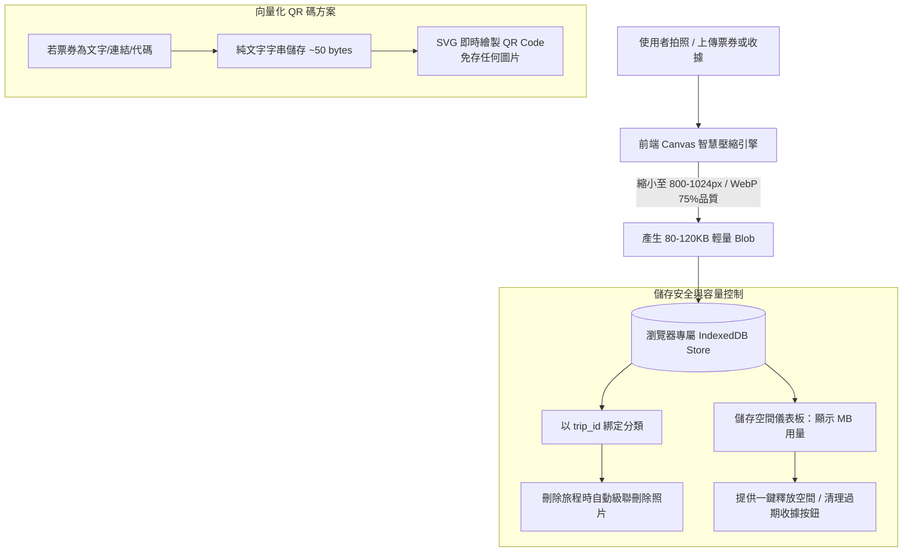
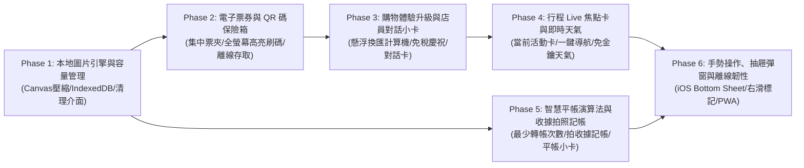

# 🚀 Travel App 體驗升級與友善功能主計畫 (Master Enhancement Plan)

> **版本**：v1.0.0  
> **定位**：極致友善（Delightful & Travel-Friendly）、輕量無後端負擔的隨行旅遊手冊  
> **核心亮點**：本地智慧壓縮圖片庫、票夾保險箱、出國店員對話速查、懸浮換匯計算機、Live 當日焦點與智慧平帳

---

## 1. 核心願景與設計哲學 (Vision & Philosophy)

本階段優化聚焦在「**旅人在路上的真實情境（On-the-road Experience）**」：
- **輕量與無雲端空間負擔（Zero Cloud Storage Dependency）**：在不增加付費雲端儲存空間（S3 / Supabase Storage）的前提下，透過純前端 Canvas 壓縮與 IndexedDB 本地儲存引擎，達成小於 100KB 的超輕量圖檔管理，並附帶透明的空間清理儀表板。
- **消滅旅途焦慮（Zero Travel Anxiety）**：過海關免翻相簿（集中票夾）、藥妝店免切計算機（懸浮換匯）、語言不通免比手畫腳（店員對話卡）、地鐵出站免找行程（當日 Live 焦點）。
- **延續 Liquid Glass 視覺高級感**：全數元件遵循毛玻璃流體美學，融入微動畫與觸覺震動回饋。

---

## 2. 核心架構技術決策：本地圖片儲存與容量防爆策略

針對「**收據拍照**」與「**票券 QR Code 集中票夾**」在**無雲端網路空間**下的儲存方案：

### 為什麼絕不塞爆瀏覽器空間？
1. **Canvas 等比壓縮（98% 瘦身）**：手機原圖 8MB $\rightarrow$ 壓縮後僅約 80~120KB。存 50 張票券與收據僅佔 **~5MB**，完全不痛不癢。
2. **純字串 QR 向量化**：高鐵/機票/Visit Japan Web 網址直接存純文字，由前端 SVG 繪製，**0 KB 圖片體積**。
3. **與旅程生命週期綁定（Cascade Delete）**：當使用者在書架刪除該趟旅程時，自動清除所有關聯圖檔。
4. **專屬清理介面（User Control）**：設定中提供「儲存空間用量統計」與「一鍵清除舊收據圖檔」，用戶擁有 100% 掌控權。

---

## 3. 六大升級階段規劃 (Phased Enhancement Roadmap)

---

## 4. 階段里程碑與文件矩陣

| 階段代號 | 階段名稱 | 核心任務與友善產出 | 規格文件連結 |
|:---|:---|:---|:---|
| **Phase 1** | **本地圖片引擎與容量管理** | 打造前端 Canvas 壓縮工具、IndexedDB 圖片倉庫、儲存空間統計與一鍵清理 UI | [`docs/enhancements/PHASE_1_STORAGE_AND_IMAGE_VAULT.md`](file:///d:/Projects/travel-app/docs/enhancements/PHASE_1_STORAGE_AND_IMAGE_VAULT.md) |
| **Phase 2** | **電子票券與 QR 碼保險箱** | Info 頁新增票夾（Voucher Wallet）、支援截圖/純文字向量 QR、全螢幕白色高亮刷碼 | [`docs/enhancements/PHASE_2_VOUCHER_PASS_WALLET.md`](file:///d:/Projects/travel-app/docs/enhancements/PHASE_2_VOUCHER_PASS_WALLET.md) |
| **Phase 3** | **購物體驗升級與店員對話小卡** | 懸浮即時換匯計算機、店員結帳日韓英對話小抄、免稅門檻達成動效與震動 | [`docs/enhancements/PHASE_3_SHOPPING_DELIGHT_AND_CLERK_CARDS.md`](file:///d:/Projects/travel-app/docs/enhancements/PHASE_3_SHOPPING_DELIGHT_AND_CLERK_CARDS.md) |
| **Phase 4** | **行程 Live 焦點卡與即時天氣** | 首頁/行程頁頂部「現在該去哪」Live 卡片、串接 Open-Meteo 免費天氣、一鍵開啟地圖 App 導航 | [`docs/enhancements/PHASE_4_LIVE_TRAVEL_DASHBOARD_AND_WEATHER.md`](file:///d:/Projects/travel-app/docs/enhancements/PHASE_4_LIVE_TRAVEL_DASHBOARD_AND_WEATHER.md) |
| **Phase 5** | **智慧平帳演算法與收據拍照記帳** | 最少轉帳次數演算法（Debt Simplification）、快速記帳整合收據存證與燈箱預覽 | [`docs/enhancements/PHASE_5_BUDGET_SPLIT_AND_RECEIPT_ATTACHMENT.md`](file:///d:/Projects/travel-app/docs/enhancements/PHASE_5_BUDGET_SPLIT_AND_RECEIPT_ATTACHMENT.md) |
| **Phase 6** | **手勢操作、抽屜彈窗與離線韌性** | 移動端 iOS Bottom Sheet 彈窗、購物/行程清單滑動手勢、觸覺震動 (Haptics) 與 PWA 離線檢視 | [`docs/enhancements/PHASE_6_OFFLINE_RESILIENCY_AND_GESTURES.md`](file:///d:/Projects/travel-app/docs/enhancements/PHASE_6_OFFLINE_RESILIENCY_AND_GESTURES.md) |

---

## 5. 品質與安全規範 (Quality & Zero Regression)

1. **嚴格不破壞現有資料結構**：既有 Supabase schema 保持向下相容，新功能利用本地端資料（IndexedDB）或現有 JSON 欄位（如 `settings_config`）擴充。
2. **完全無外部付費 API 依賴**：
   - 天氣：使用 Open-Meteo（開源、免 API Key、高精準度預報）。
   - QR Code：使用輕量前端 SVG 向量渲染套件（如 `qrcode.react`）。
3. **行動端優先（Mobile-First Touch Target）**：所有點擊區域維持在 44x44px 以上，支援單手操作。
