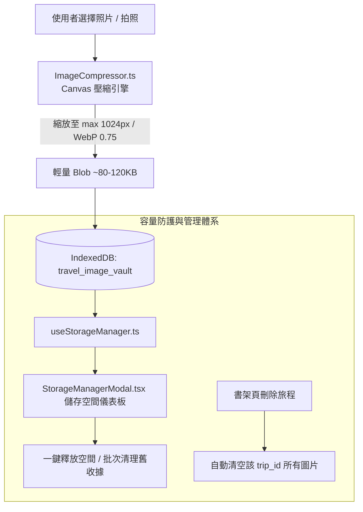

# 💾 Phase 1: 本地輕量圖片引擎與容量管理系統 (Image Vault & Storage Manager)

> **狀態**：✅ 已完成 (Completed)  
> **核心目標**：在**零雲端儲存空間負擔**下，建立超高壓縮率前端圖片引擎、IndexedDB 儲存庫，並提供透明的容量統計與空間清理介面，徹底免除瀏覽器容量膨脹疑慮。

---

## 1. 痛點分析與儲存技術原理 (Why & How)

### 1.1 核心疑慮解答
* **問題**：「如果把收據或 QR Code 存在本地，是否會讓 App 或網頁儲存空間越來越大且沒有地方清除？」
* **技術真相**：
  1. 若使用 `localStorage` 存原始 Base64：瀏覽器限制僅 5MB，存 1~2 張手機照片就會噴出 `QuotaExceededError` 崩潰。
  2. 若使用 `IndexedDB` 存手機未壓縮原圖：現代 iPhone/Android 照片單張 4MB~10MB，存 30 張就會消耗 200MB 以上，且若無清理機制，會一直佔用使用者手機容量。
* **解法方案（本階段核心）**：
  - **98% 極致瘦身**：所有照片進入 IndexedDB 前，一律經過 HTML5 Canvas 自動縮圖（最大邊長 1024px、WebP 格式、品質 0.75）。收據或票券單張平均僅 **80KB ~ 120KB**，即使存 100 張收據也僅耗費 **~10MB**！
  - **關聯級聯清理（Cascade Delete）**：當使用者在書架刪除該趟旅程時，自動清除 IndexedDB 內該 `trip_id` 的所有圖檔。
  - **用戶掌控的清理後台（Storage Manager）**：在 App 設定中提供「儲存空間儀表板」，清楚顯示「已使用 4.2 MB / 18 張圖檔」，並提供一鍵「清除過期收據圖片」、「釋放所有圖片快取」。

---

## 2. 模組架構設計 (Architecture)



---

## 3. 目標檔案矩陣 (Target File Matrix)

| 操作 | 檔案路徑 | 職責與說明 |
|:---|:---|:---|
| **新增** | `src/utils/ImageCompressor.ts` | 純前端 Canvas 壓縮工具，支援等比縮放、WebP 降轉、EXIF 旋轉修正 |
| **新增** | `src/services/storage/ImageVaultDB.ts` | 封裝 IndexedDB 存取（儲存 Blob、依 tripId 查詢、刪除、計算總位元組） |
| **新增** | `src/hooks/storage/useStorageManager.ts` | 取得當前總用量（MB）、圖片張數、執行清空或單項刪除的 Hook |
| **新增** | `src/components/common/StorageManagerModal.tsx` | 毛玻璃儲存空間管理彈窗，以進度條與卡片展示空間用量並提供清理按鈕 |
| **整合** | [`src/page/BookshelfPage.tsx`](file:///d:/Projects/travel-app/src/page/BookshelfPage.tsx) | 在刪除旅程邏輯中加入級聯清理 `ImageVaultDB.clearTripImages(tripId)` |
| **整合** | [`src/components/common/SystemControls.tsx`](file:///d:/Projects/travel-app/src/components/common/SystemControls.tsx) | 新增「儲存空間管理」快捷入口 |

---

## 4. 關鍵介面型別定義 (Types)

```typescript
export interface StoredImageRecord {
    id: string;               // 唯一 UUID
    trip_id: string;          // 關聯旅程 ID
    type: 'receipt' | 'voucher' | 'misc'; // 圖檔分類
    name: string;             // 備註名稱
    blob: Blob;               // 壓縮後的二進位圖檔
    mime_type: string;        // 'image/webp' | 'image/jpeg'
    size_bytes: number;       // 圖檔大小（位元組）
    created_at: string;       // ISO 日期字串
}

export interface StorageUsageSummary {
    total_bytes: number;      // 總使用位元組
    total_mb: string;         // 格式化後 MB (例如 "3.4 MB")
    receipt_count: number;    // 收據張數
    voucher_count: number;    // 票券張數
    quota_percent?: number;   // 預估安全比例
}
```

---

## 5. 驗收標準 (Acceptance Criteria)

1. [x] 上傳手機拍照照片，經 `ImageCompressor` 壓縮後體積減少 90% 以上（< 150KB），文字與條碼仍清晰可辨。
2. [x] 儲存至 IndexedDB 成功，能在離線無網路環境下順暢讀取顯示。
3. [x] 開啟「儲存空間管理」彈窗，能精確顯示當前佔用的 MB 數與圖片張數。
4. [x] 點擊「一鍵清理收據快取」或「清除旅程」，IndexedDB 空間即時釋放，用量數據即時歸零更新。
