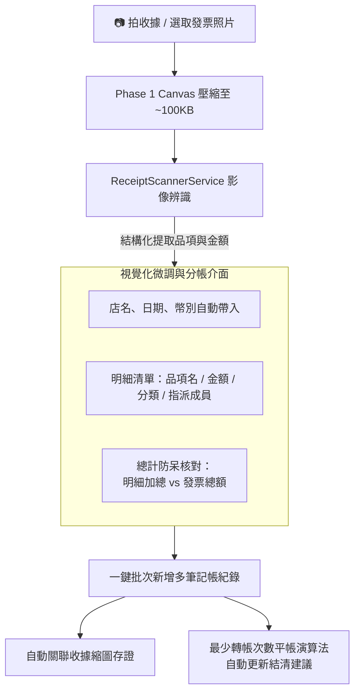

# 🧾 Phase 5: 智慧平帳演算法、收據辨識與批次記帳分帳 (Smart Debt Split & Receipt Scanner)

> **狀態**：已完成 (Completed)  
> **前置需求**：[Phase 1: 本地圖片引擎與容量管理](file:///d:/Projects/travel-app/docs/enhancements/PHASE_1_STORAGE_AND_IMAGE_VAULT.md)  
> **核心目標**：解決旅途結束後「大家算帳轉來轉去算不清楚」的困擾，並提供**拍收據影像辨識、自動批次產生記帳項目、微調與分帳**的極速記帳體驗。

---

## 1. 痛點分析與記帳情境 (Budget & Expense Scenarios)

* **情境 1：結算時帳目混亂（誰該轉給誰多少錢）**
  - 旅行 5 天下來，A 幫大家付了門票、B 刷了居酒屋、C 買了車票。最後大家坐下來對帳，A 欠 B、B 欠 C、C 欠 A，互相轉帳 10 幾次手續費暴增，算到頭痛。
* **情境 2：雙手提戰利品，一張長收據不想逐項手打輸入**
  - 在藥妝店或超市拿到長長一條收據，上面有 6~8 個品項（包含幫不同朋友代買的藥妝、大家一起吃的零食），一項一項手動打字輸入金額非常繁瑣。
  - 希望能「**拍一張收據自動辨識所有明細 $\rightarrow$ 點擊旅伴頭像分配這項是誰的 $\rightarrow$ 一鍵批次寫入記帳庫**」。

---

## 2. 解決方案與功能亮點 (Key Features)



### 2.1 收據影像辨識與自動批次記帳 (Receipt Recognition & Batch Expenses)
1. **多模態智能辨識（支援免費 Gemini Flash API 或本地端輔助）**：
   - 使用者拍攝收據後，系統智慧提取：
     - **店名（Store Name）**、**日期（Date）**、**幣別（Currency）**、**收據總額（Total Amount）**
     - **各商品明細（Line Items）**：商品名稱、單價、數量、建議類別（餐飲、購物、交通等）。
2. **收據明細檢視與分帳確認卡（`ReceiptBatchSplitModal`）**：
   - **成員快速指派膠囊（Avatar Tag）**：每一項商品旁邊提供旅伴頭像標籤，點一下即可切換「小明」、「小美」或「全員均分」。
   - **即時微調**：可手動修改品項名稱、調整金額、合併零星項目或刪除不需記帳的行（如塑膠袋）。
   - **總額防呆驗證**：底部動態計算「已指派明細加總 vs 收據總額」，綠色勾勾表示無遺漏。
   - **一鍵批次寫入**：確認後一次性新增多筆 Budget 紀錄，並將壓縮後的收據照片自動綁定關聯至記帳項目。

### 2.2 最佳化最少轉帳平帳演算法 (Debt Simplification)
1. **貪婪餘額匹配演算法（Greedy Balance Settlement）**：
   - 計算每位成員整趟旅程的「淨差額（Net Balance = 總墊付 - 總應付）」。
   - 自動抵銷環形債務，將轉帳筆數壓縮至理論最少（最多 N-1 筆）。
2. **LINE 群組一鍵複製文字**：自動生成排版清晰的結清指令：
   ```text
   🎉 【東京五日遊】旅費平帳建議（只需 2 筆轉帳）：
   1. 小明 ➡️ 轉給 艾力克：NT$ 1,250
   2. 小美 ➡️ 轉給 艾力克：NT$ 820
   ✅ 全員平帳完成！
   ```

---

## 3. 目標檔案矩陣 (Target File Matrix)

| 操作 | 檔案路徑 | 職責與說明 |
|:---|:---|:---|
| **新增** | `src/models/types/ReceiptScannerTypes.ts` | 收據掃描提取之結構化資料介面（店名、明細列、分帳對象） |
| **新增** | `src/services/receipt/ReceiptScannerService.ts` | 收據影像辨識服務（支援 Gemini Vision / 本地正則多模式） |
| **新增** | `src/components/budget/ReceiptBatchSplitModal.tsx` | 收據明細檢視、成員指派、微調與批次記帳彈窗 |
| **新增** | `src/utils/DebtSimplifierUtil.ts` | 最少轉帳次數核心演算法與 LINE 結算訊息排版 |
| **新增** | `src/components/budget/SmartSettlementModal.tsx` | 毛玻璃智慧平帳建議彈窗（含可視化轉帳箭頭與一鍵複製） |
| **新增** | `src/components/budget/ReceiptViewerModal.tsx` | 收據照片燈箱檢視器（支援旋轉、縮放） |
| **整合** | [`src/components/budget/SplitInfoModal.tsx`](file:///d:/Projects/travel-app/src/components/budget/SplitInfoModal.tsx) | 加入「最少轉帳結算」切換分頁 |
| **整合** | [`src/components/budget/QuickExpenseBar.tsx`](file:///d:/Projects/travel-app/src/components/budget/QuickExpenseBar.tsx) | 加入相機拍收據入口，觸發收據辨識與批次拆帳流程 |
| **整合** | [`src/components/budget/TransactionList.tsx`](file:///d:/Projects/travel-app/src/components/budget/TransactionList.tsx) | 項目顯示收據預覽縮圖與點擊開燈箱 |

---

## 4. 驗收標準 (Acceptance Criteria)

1. [x] 拍攝或上傳收據後，系統能解析出品項名稱、金額與總計，並在 `ReceiptBatchSplitModal` 中條列呈現。
2. [x] 使用者可為各品項快速指派墊付與分攤成員，並能自由增刪修改品項。
3. [x] 點擊批次儲存後，能一次性在預算列表中建立多筆關聯交易，並能點擊檢視收據照片。
4. [x] 多人分帳場景下，平帳演算法能準確抵銷環形債務，將轉帳筆數降到最低（最多 N-1 筆）。
5. [x] 點擊「複製 LINE 結算訊息」可複製結構化清晰的轉帳指示。
