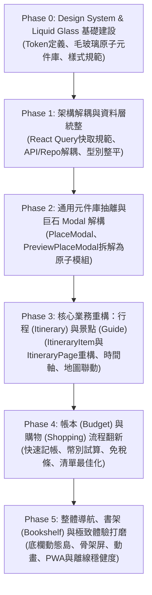

# 🗺️ Travel App 全方位重構主計畫 (Master Refactor Plan)

> **版本**：v1.0.0  
> **專案定位**：現代化離線優先（Offline-First）旅遊規劃與隨行助理 Web App  
> **技術棧**：React 19, TypeScript, Tailwind CSS v4, Vite / Rolldown, TanStack React Query v5, Supabase, RxDB, Leaflet / MapLibre, dnd-kit

---

## 1. 重構願景與核心價值 (Vision & Objectives)

本專案經過多次功能迭代，累積了強大的旅遊規劃能力（地標搜尋、時間軸排程、路線最佳化、預算拆帳、免稅購物記帳、離線地圖等）。但隨著功能擴張，目前核心頁面與元件出現顯著的**巨石化（Monolithic Components）**、**職責耦合（Tight Coupling）**與**樣式不一致**問題。

### 核心目標：
1. **程式碼優化與可讀性（Code Cleanliness & Maintainability）**：
   - 瓦解超大巨石元件（如 `PlaceModal.tsx` >2000行、`ItineraryItem.tsx` >1100行、`ItineraryPage.tsx` >880行、`ShoppingItemModal.tsx` >1000行）。
   - 消除重複邏輯與狀態計算，建立統一清晰的資料流與生命週期。
2. **元件高度重複使用（Component Reusability & DRY）**：
   - 提取統一的 Modal 系統、通用表單輸入（貨幣、時間、標籤、客製下拉）、語音朗讀、圖片預覽、評分徽章等原子元件。
   - 杜絕在多處獨立重複撰寫相同的 UI 卡片與對話框。
3. **現代 UI 設計：Liquid Glass (液態水滴毛玻璃流體美學)**：
   - 告別生硬純色塊，升級為具備光感、微模糊（Backdrop Blur）、環境光溢色、柔和邊框（Specular Highlight）與半透明質感的 Liquid Glass 設計系統。
   - 配合平滑微動畫（Micro-interactions）與觸覺彈簧反饋，賦予如 iOS 18 / VisionOS 般的高級感。
4. **使用者流程友善改善（User Experience & Flow Delight）**：
   - 手機與桌面響應式最佳化（如行程與地圖聯動、快速切換天數、直覺的手勢操作與快捷鍵）。
   - 明確的載入狀態、微骨架屏（Skeleton Loading）、更具防呆保護與即時回饋的操作流程。

---

## 2. 重構六大階段規劃 (Phased Roadmap)

為確保重構過程**低風險、步步可測試、隨時可交付**，重構劃分為以下 6 個漸進式階段：

---

## 3. 階段里程碑與文件矩陣

每一階段皆具備獨立的詳細規格書、執行 Prompt 與跨階段交接文件：

| 階段代號 | 階段名稱 | 核心產出與焦點 | 規格與交接文件路徑 |
|:---|:---|:---|:---|
| **Phase 0** | **Design System & Liquid Glass** | CSS 變數定義、Liquid Glass 核心元件庫、Typography 與微動畫基礎 | [`docs/refactor/PHASE_0_DESIGN_SYSTEM_AND_LIQUID_GLASS.md`](file:///d:/Projects/travel-app/docs/refactor/PHASE_0_DESIGN_SYSTEM_AND_LIQUID_GLASS.md) |
| **Phase 1** | **Data Layer & Architecture** | 移除 View 中的 Repo 呼叫、規範 TanStack Query Key 與樂觀更新、清理重複 Type | [`docs/refactor/PHASE_1_DATA_LAYER_AND_ARCHITECTURE.md`](file:///d:/Projects/travel-app/docs/refactor/PHASE_1_DATA_LAYER_AND_ARCHITECTURE.md) |
| **Phase 2** | **Common Components & Modal Decoupling** | 解構 2000 行 `PlaceModal` & `PreviewPlaceModal`，抽取通用表單/彈窗 Compound 元件 | [`docs/refactor/PHASE_2_COMMON_COMPONENTS_AND_MODAL_DECOUPLING.md`](file:///d:/Projects/travel-app/docs/refactor/PHASE_2_COMMON_COMPONENTS_AND_MODAL_DECOUPLING.md) |
| **Phase 3** | **Itinerary & Guide Experience** | 解構 1100 行 `ItineraryItem`、優化時間軸排程、天氣小工具、手機/桌面地圖抽屜聯動 | [`docs/refactor/PHASE_3_ITINERARY_AND_GUIDE_EXPERIENCE.md`](file:///d:/Projects/travel-app/docs/refactor/PHASE_3_ITINERARY_AND_GUIDE_EXPERIENCE.md) |
| **Phase 4** | **Shopping & Budget Optimization** | 解構 `ShoppingItemModal`、購物批次轉預算、多幣別切換、動態分帳與免稅計算條升級 | [`docs/refactor/PHASE_4_SHOPPING_AND_BUDGET_OPTIMIZATION.md`](file:///d:/Projects/travel-app/docs/refactor/PHASE_4_SHOPPING_AND_BUDGET_OPTIMIZATION.md) |
| **Phase 5** | **Shell, Bookshelf & UX Polish** | 打造 Liquid Glass 懸浮底欄/側欄、書架封面 3D 卡片、離線/骨架屏、PWA 手勢優化 | [`docs/refactor/PHASE_5_SHELL_NAVIGATION_AND_UX_DELIGHT.md`](file:///d:/Projects/travel-app/docs/refactor/PHASE_5_SHELL_NAVIGATION_AND_UX_DELIGHT.md) |

---

## 4. 執行準則 (Execution Principles)

1. **不可中斷現有業務邏輯 (Zero Regression)**：
   - 任何階段的重構不得遺失原有的離線存取、多語系朗讀、換匯計算、時間衝突計算等關鍵功能。
2. **檔案粒度控制**：
   - 單一 React 元件原則上不應超過 300 行；若超過 400 行必須檢查是否包含可拆解的子元件或自訂 Hook。
3. **TypeScript 嚴格型別**：
   - 嚴格禁止使用 `any`；通用事件或表單需具備精確 Generic 型別宣告。
4. **驗收自測**：
   - 每個階段重構完成後，執行 `npm run build` 確認編譯無 TypeScript 錯誤，並在瀏覽器驗證核心路徑。
