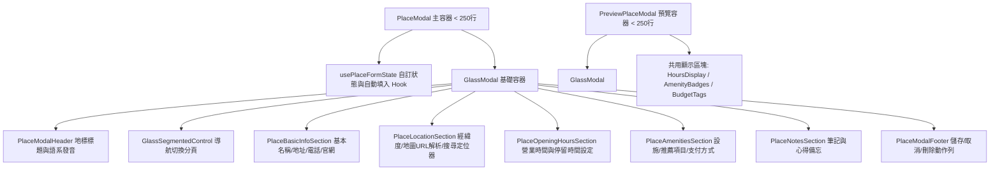

# 🧩 Phase 2: 通用元件庫抽離與巨石 Modal 解構 (Common Components & Modal Decoupling)

> **狀態**：已完成 (Completed)  
> **前置需求**：[Phase 0](file:///d:/Projects/travel-app/docs/refactor/PHASE_0_DESIGN_SYSTEM_AND_LIQUID_GLASS.md) 與 [Phase 1](file:///d:/Projects/travel-app/docs/refactor/PHASE_1_DATA_LAYER_AND_ARCHITECTURE.md) 完成  
> **核心任務**：瓦解高達 2,047 行的 `PlaceModal.tsx` 與 1,500 行的 `PreviewPlaceModal.tsx`，建立模組化地標編輯與預覽體系，並將彈窗全面升級為 Liquid Glass 質感。

---

## 1. 現況分析與痛點 (Current State & Pain Points)

- **現狀**：
  - `PlaceModal.tsx` 超過 2,000 行，包含大量地標搜尋（OSM / Kakao）、地圖 URL 解析、多語系朗讀、營業時間輸入、自訂時間選單、花費預算、標籤管理、設施勾選等所有狀態與 UI，嚴重違背單一職責原則（Single Responsibility Principle）。
  - `PreviewPlaceModal.tsx` 超過 1,500 行，複製貼上了與 `PlaceModal` 極為相似的顯示樣式（營業時間、設施圖示、支付管道、推薦餐點等），程式碼重複率極高。
  - 彈窗缺乏平滑過渡動畫，在手機小螢幕上捲動與操作時容易誤觸。
- **目標**：
  - 將 2,000 行的巨石拆分為 5~6 個小巧、具獨立職責的模組（每個 < 250 行）。
  - 將地標預覽與編輯共用的區塊抽成通用 View 元件。
  - 將地標表單的狀態邏輯、驗證與外部 API 填入提取為專用 Hook `usePlaceFormState`。
  - 全面導入 Phase 0 的 `GlassModal` 體系。

---

## 2. 元件解構架構設計 (Component Architecture)



### 2.1 拆解後的檔案職責劃分

1. **`src/components/place/modal/usePlaceFormState.ts`**
   - 負責維護表單暫存狀態、自動計算經緯度、OSM 地名反查、Map URL 貼上自動解析。
2. **`src/components/place/modal/PlaceModalHeader.tsx`**
   - 包含景點名稱、多語系語音發音按鈕（整合 `playPronunciation`）、分類切換下拉。
3. **`src/components/place/modal/PlaceBasicInfoSection.tsx`**
   - 景點中英文名稱、地址、電話、評分、官方網站。
4. **`src/components/place/modal/PlaceLocationSection.tsx`**
   - 整合地圖 URL 解析按鈕、經緯度精確輸入、喚起 `PlaceSearchMapPickerModal` 地圖選點。
5. **`src/components/place/modal/PlaceOpeningHoursSection.tsx`**
   - 每日營業時間表、特殊休假日設定、預計建議停留時間（TimeSelect）。
6. **`src/components/place/modal/PlaceAmenitiesSection.tsx`**
   - 包含 Wi-Fi、插座、信用卡/電子支付、推薦必點項目清單。
7. **`src/components/place/modal/PlaceModal.tsx`**
   - 主組合裝配入口，簡化至 200 行以內，負責分頁導航與區塊渲染。
8. **`src/components/place/modal/PreviewPlaceModal.tsx`**
   - 簡化至 250 行以內，直接引用共用的展示型原子元件（如 `OpeningHoursViewer`, `AmenitiesList`）。

---

## 3. 目標檔案矩陣 (Target File Matrix)

| 操作 | 檔案路徑 | 說明 |
|:---|:---|:---|
| **新增** | `src/components/place/modal/usePlaceFormState.ts` | 地標表單狀態與外部 API 自動解析 Hook |
| **新增** | `src/components/place/modal/PlaceModalHeader.tsx` | 彈窗頂部與語音朗讀條 |
| **新增** | `src/components/place/modal/PlaceBasicInfoSection.tsx` | 基礎欄位編輯表單 |
| **新增** | `src/components/place/modal/PlaceLocationSection.tsx` | 地理位置與地圖選點整合 |
| **新增** | `src/components/place/modal/PlaceOpeningHoursSection.tsx` | 營業時段編輯 |
| **新增** | `src/components/place/modal/PlaceAmenitiesSection.tsx` | 設施與支付方式清單 |
| **重寫** | [`src/components/place/PlaceModal.tsx`](file:///d:/Projects/travel-app/src/components/place/PlaceModal.tsx) | 大幅精簡為組合容器 (<250行) |
| **重寫** | [`src/components/itinerary/PreviewPlaceModal.tsx`](file:///d:/Projects/travel-app/src/components/itinerary/PreviewPlaceModal.tsx) | 精簡為共享展示模組 (<250行) |
| **重構** | [`src/components/common/DeleteModal.tsx`](file:///d:/Projects/travel-app/src/components/common/DeleteModal.tsx) | 改用 `GlassModal` 與 `GlassButton` 升級質感 |

---

## 4. 執行用 Prompt (Execution Prompt)

> 複製以下 Prompt 給 AI 即可啟動 Phase 2 執行：

```markdown
請依照 [PHASE_2_COMMON_COMPONENTS_AND_MODAL_DECOUPLING.md](file:///d:/Projects/travel-app/docs/refactor/PHASE_2_COMMON_COMPONENTS_AND_MODAL_DECOUPLING.md) 規格執行 Phase 2:

【任務目標】
將超過 2000 行的 `PlaceModal.tsx` 與 1500 行的 `PreviewPlaceModal.tsx` 徹底解構為職責分明的子元件與專用 Hook，並套用 Phase 0 的 Liquid Glass Modal 容器。

【具體工作項目】
1. 建立 `src/components/place/modal/` 目錄並實作:
   - `usePlaceFormState.ts`: 抽取表單狀態變更、OSM 查詢解析、地圖 URL 解析、輸入驗證。
   - `PlaceModalHeader.tsx`: 包含景點名稱、分類選擇、多語系朗讀發音按鈕。
   - `PlaceBasicInfoSection.tsx`: 地址、聯絡方式、外部官網連結。
   - `PlaceLocationSection.tsx`: 地標座標與地圖選點器連結。
   - `PlaceOpeningHoursSection.tsx`: 營業時間表與停留時間。
   - `PlaceAmenitiesSection.tsx`: 支付管道、設施與必看/必買清單。
2. 重構 `PlaceModal.tsx`:
   - 移除所有內聯的龐大 JSX，改為引入上述子模組。
   - 使用 `GlassModal` 做為外層彈窗容器，行數控制在 250 行以內。
3. 重構 `PreviewPlaceModal.tsx`:
   - 提取可複用的展示型區塊，消除重複程式碼，行數控制在 250 行以內。
4. 升級 `DeleteModal.tsx` 為 Liquid Glass 樣式風格。
5. 驗證:
   - 執行 `npm run build`，確保新增景點、編輯景點、查看景點預覽彈窗功能 100% 完整無回退。
```

---

## 5. 驗收標準 (Acceptance Criteria)

- [x] `PlaceModal.tsx` 與 `PreviewPlaceModal.tsx` 程式碼行數各降至 300 行以內（實際分別為 236 行與 166 行）。
- [x] 景點新增、編輯、地圖 URL 解析自動填入座標、多語系發音、營業時間編輯等原有功能完全正常運作。
- [x] 彈窗在桌面與手機端展現優雅的 Liquid Glass 背景模糊與滑入彈簧微動畫，操作流暢無卡頓。
- [x] `npm run build` 通過，無型別錯誤。

---

## 6. 交接文件給 Phase 3 (Handover to Phase 3)

### 產出清單：
- 模組化的地標編輯元件庫：`src/components/place/modal/`。
- 精簡且美觀的 `PlaceModal` 與 `PreviewPlaceModal`。
- 輕量化的通用刪除確認彈窗 `DeleteModal`。

### Phase 3 須知：
- Phase 3 將直接重構旅遊 App 最核心的兩大頁面：`ItineraryPage.tsx` 與 `ItineraryItem.tsx`（合計超過 2,000 行）。
- 行程項目中點擊景點檢視與編輯時，將直接呼叫 Phase 2 產出的輕量化 Modal，使行程時間軸的渲染效能顯著躍升。
