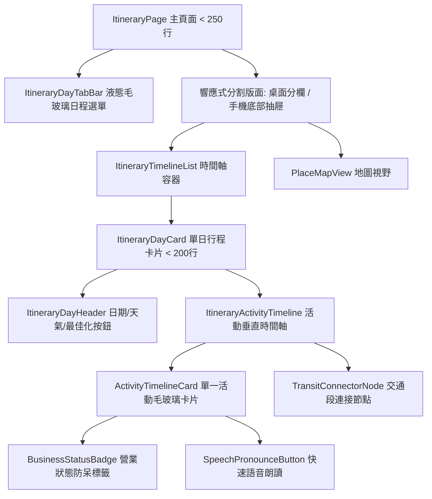

# 🚀 Phase 3: 核心業務重構：行程 (Itinerary) 與景點 (Guide)

> **狀態**：已完成 (Completed)  
> **前置需求**：[Phase 1](file:///d:/Projects/travel-app/docs/refactor/PHASE_1_DATA_LAYER_AND_ARCHITECTURE.md) 與 [Phase 2](file:///d:/Projects/travel-app/docs/refactor/PHASE_2_COMMON_COMPONENTS_AND_MODAL_DECOUPLING.md) 完成  
> **核心任務**：徹底重構旅遊核心心臟——1,164 行的 `ItineraryItem.tsx` 與 884 行的 `ItineraryPage.tsx`，升級為流體毛玻璃時間軸、流暢手機地圖聯動與絲滑拖曳體驗。

---

## 1. 現況分析與痛點 (Current State & Pain Points)

- **現狀**：
  - `ItineraryItem.tsx`（1,164 行）集成了天氣請求、單日時間軸排程、活動卡片渲染、交通接駁段、營業時間防呆警告、發音播放等全部邏輯，造成每當使用者拖曳或展開單日，整個元件觸發大規模非必要重新計算與重繪。
  - `ItineraryPage.tsx`（884 行）負責管理單日切換、地圖雙向聯動、批次地標讀取、路線最佳化彈窗等，在手機端開關地圖時採用了生硬的彈窗模式（`showMobileMap`），割裂了「查看時間軸」與「查看地圖定位」的使用者心智流暢度。
  - 時間軸視覺設計偏向傳統邊框線，未具備層次感與現代流體美學。

---

## 2. 元件解構與時間軸架構設計 (Component Architecture)



### 2.1 拆解後模組規劃

1. **`src/components/itinerary/timeline/ItineraryDayTabBar.tsx`**
   - 橫向滑動的液態膠囊按鈕群，顯示「第 N 天 / 星期幾 / 幾月幾號」，具備流暢吸頂效果與目前選取指示器。
2. **`src/components/itinerary/timeline/ItineraryDayHeader.tsx`**
   - 單日標題列、展開/收合開關、天氣徽章（使用 Phase 1 的 `useDailyWeather`）、路線最佳化入口與新增活動按鈕。
3. **`src/components/itinerary/timeline/ActivityTimelineCard.tsx`**
   - 單個活動的 Liquid Glass 卡片，支援時間點、停留時間、地標名稱、照片縮圖、自訂筆記、快速語音按鈕、編輯/刪除浮動選單。
4. **`src/components/itinerary/timeline/TransitConnectorNode.tsx`**
   - 兩活動間的交通連線節點（步行、地鐵、開車、所需時間），點擊可展開導航選項。
5. **`src/components/itinerary/timeline/BusinessStatusBadge.tsx`**
   - 根據活動排定時間與地標營業時間比對，若遇店家公休或非營業時段，顯示精緻柔和的琥珀色/警示色 Glass 警示標籤。
6. **`src/components/itinerary/ItineraryItem.tsx`**
   - 精簡為單日行程的協調控制器（<200行）。
7. **`src/components/itinerary/ItineraryPage.tsx`**
   - 精簡為主頁面排版容器（<250行），提供手機端如 Apple Maps 般流暢的「抽屜式」或雙分割面板體驗。

---

## 3. 目標檔案矩陣 (Target File Matrix)

| 操作 | 檔案路徑 | 說明 |
|:---|:---|:---|
| **新增** | `src/components/itinerary/timeline/ItineraryDayTabBar.tsx` | 毛玻璃橫向滑動日程列 |
| **新增** | `src/components/itinerary/timeline/ItineraryDayHeader.tsx` | 日程標題與天氣小工具 |
| **新增** | `src/components/itinerary/timeline/ActivityTimelineCard.tsx` | 獨立活動時間軸卡片 |
| **新增** | `src/components/itinerary/timeline/TransitConnectorNode.tsx` | 交通連線節點與導航指示 |
| **新增** | `src/components/itinerary/timeline/BusinessStatusBadge.tsx` | 營業時段防呆警示標籤 |
| **重構** | [`src/components/itinerary/ItineraryItem.tsx`](file:///d:/Projects/travel-app/src/components/itinerary/ItineraryItem.tsx) | 大幅精簡為組合模組 (<200行) |
| **重構** | [`src/page/Book/ItineraryPage.tsx`](file:///d:/Projects/travel-app/src/page/Book/ItineraryPage.tsx) | 大幅精簡版面與地圖聯動邏輯 (<250行) |
| **優化** | [`src/page/Book/GuidePage.tsx`](file:///d:/Projects/travel-app/src/page/Book/GuidePage.tsx) | 統一採用 Phase 0 Liquid Glass 卡片排版 |

---

## 4. 執行用 Prompt (Execution Prompt)

> 複製以下 Prompt 給 AI 即可啟動 Phase 3 執行：

```markdown
請依照 [PHASE_3_ITINERARY_AND_GUIDE_EXPERIENCE.md](file:///d:/Projects/travel-app/docs/refactor/PHASE_3_ITINERARY_AND_GUIDE_EXPERIENCE.md) 規格執行 Phase 3:

【任務目標】
將超過 1100 行的 `ItineraryItem.tsx` 與近 900 行的 `ItineraryPage.tsx` 全面重構解耦，升級為現代 Liquid Glass 時間軸介面與流暢地圖聯動。

【具體工作項目】
1. 建立 `src/components/itinerary/timeline/` 目錄並實作以下模組:
   - `ItineraryDayTabBar.tsx`: 具備流暢橫向捲動的液態毛玻璃天數切換列，標示星期與日期。
   - `ItineraryDayHeader.tsx`: 日期標題、收合展開、天氣小卡 (整合 Phase 1 useDailyWeather)、排程操作功能按鈕。
   - `ActivityTimelineCard.tsx`: 垂直時間軸上的活動項目卡片，使用 GlassCard 呈現，包含時間標籤、圖示、景點中英文名、語音朗讀、備註與動作選單。
   - `TransitConnectorNode.tsx`: 活動間的交通圖示與移動時間連線節點。
   - `BusinessStatusBadge.tsx`: 營業時間衝突/公休警示膠囊標籤。
2. 重構 `ItineraryItem.tsx`:
   - 移除巨石內聯邏輯，組合上述子元件，總行數降至 200 行以內。
3. 重構 `ItineraryPage.tsx`:
   - 採用 Phase 1 的 `useTripPlacesBatch` 取代內部的 `placeRepo` 手工查詢。
   - 優化手機與桌面的響應式版面，地圖與行程切換具備流暢過渡，總行數降至 250 行以內。
4. 升級 `GuidePage.tsx`:
   - 景點列表卡片導入 Liquid Glass 樣式，統一視覺語言。
5. 驗證:
   - 執行 `npm run build` 確認編譯成功。
   - 驗證行程時間計算、新增/編輯活動、拖曳排序、天氣載入與地圖圖釘聯動完全正常。
```

---

## 5. 驗收標準 (Acceptance Criteria)

- [x] `ItineraryItem.tsx`（164 行）與 `ItineraryPage.tsx`（247 行）程式碼行數各自降至 250 行以內。
- [x] 時間軸排程計算無誤，活動間交通節點資訊正確顯示。
- [x] 營業時間警告、天氣載入、地圖懸浮/點擊圖釘聚焦功能正常運作且效能流暢。
- [x] 手機小螢幕下操作日程與檢視地圖絲滑無跳閃，無版面溢出（Horizontal Overflow）。

---

## 6. 交接文件給 Phase 4 (Handover to Phase 4)

### 產出清單：
- 高效能、模組化的行程時間軸元件群：`src/components/itinerary/timeline/`。
- 具備液態毛玻璃質感的 `ItineraryPage` 與 `GuidePage`。

### Phase 4 須知：
- Phase 4 將著手重構隨行旅遊非常依賴的**購物（Shopping）與記帳預算（Budget）模組**。
- 購物頁的 `ShoppingItemModal`（54KB）與記帳頁的 `BudgetPage`（30KB）將套用相同的 Liquid Glass 與模組化解耦模式。
