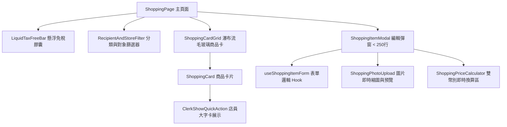

# 💳 Phase 4: 帳本 (Budget) 與購物 (Shopping) 流程翻新

> **狀態**：待執行 (Pending)  
> **前置需求**：[Phase 0](file:///d:/Projects/travel-app/docs/refactor/PHASE_0_DESIGN_SYSTEM_AND_LIQUID_GLASS.md)、[Phase 1](file:///d:/Projects/travel-app/docs/refactor/PHASE_1_DATA_LAYER_AND_ARCHITECTURE.md) 與 [Phase 2](file:///d:/Projects/travel-app/docs/refactor/PHASE_2_COMMON_COMPONENTS_AND_MODAL_DECOUPLING.md) 完成  
> **核心任務**：解構 54KB 的 `ShoppingItemModal.tsx` 與 30KB 的 `BudgetPage.tsx`，升級免稅進度膠囊、極速記帳體驗與雙幣別動態試算。

---

## 1. 現況分析與痛點 (Current State & Pain Points)

- **現狀**：
  - `ShoppingItemModal.tsx`（>1,000 行）揉雜了圖片預覽上傳、採購對象分派、店面綁定、單價/數量試算、免稅切換、幣別換算等邏輯，使用者在實體店面趕著購物時操作門檻高。
  - `TaxFreeBar.tsx`（近 20KB）計算免稅門檻的視覺回饋偏硬，缺乏動態達成慶祝與吸頂浮動感。
  - `BudgetPage.tsx` 與 `TransactionModal.tsx` 的花費輸入流程繁複，在旅途中單手操作記帳耗時，分類切換與分帳（Split Info）互動不夠直覺。
- **目標**：
  - 打造「**出國極速記帳模式**」：預設焦點、一鍵預設分類、自動帶入匯率換算。
  - 免稅計算條（Tax Free Bar）升級為 **Liquid Glass 懸浮進度動態膠囊**，即時標記距離免稅門檻尚差多少金額。
  - 店員展示卡（`ClerkShowModal`）支援大字模式與自動螢幕高光，方便向日本/國外店員直接出示。

---

## 2. 模組重構與架構設計 (Module Architecture)

### 2.1 購物模組解構 (`src/components/shopping/`)


### 2.2 預算與記帳模組解構 (`src/components/budget/`)
- **`src/components/budget/QuickExpenseBar.tsx`**：旅途中單手 3 秒記帳快捷列，常見類別（餐飲、交通、門票、伴手禮）一鍵點選。
- **`src/components/budget/BudgetOverviewCard.tsx`**：總花費、剩餘預算百分比、雙幣別總計之毛玻璃視覺儀表板。
- **`src/components/budget/SplitBillModal.tsx`**：解耦分帳邏輯，支援均分、指定金額、自訂成員比例計算。

---

## 3. 目標檔案矩陣 (Target File Matrix)

| 操作 | 檔案路徑 | 說明 |
|:---|:---|:---|
| **新增** | `src/components/shopping/modal/useShoppingItemForm.ts` | 購物項目表單狀態與計算 Hook |
| **新增** | `src/components/shopping/modal/ShoppingPriceSection.tsx` | 幣別轉換與單價數量計算區塊 |
| **新增** | `src/components/shopping/LiquidTaxFreeBar.tsx` | 毛玻璃流動進度免稅計算條 |
| **新增** | `src/components/budget/QuickExpenseBar.tsx` | 行動端單手極速記帳入口 |
| **重構** | [`src/components/shopping/ShoppingItemModal.tsx`](file:///d:/Projects/travel-app/src/components/shopping/ShoppingItemModal.tsx) | 解構為子模組裝配 (<250行) |
| **重構** | [`src/components/shopping/ShoppingCard.tsx`](file:///d:/Projects/travel-app/src/components/shopping/ShoppingCard.tsx) | 採用 GlassCard 提升視覺通透感 |
| **重構** | [`src/page/Book/BudgetPage.tsx`](file:///d:/Projects/travel-app/src/page/Book/BudgetPage.tsx) | 模組化拆分儀表板與交易清單 (<250行) |
| **重構** | [`src/components/budget/TransactionModal.tsx`](file:///d:/Projects/travel-app/src/components/budget/TransactionModal.tsx) | 升級為 GlassModal 並簡化分帳流程 |

---

## 4. 執行用 Prompt (Execution Prompt)

> 複製以下 Prompt 給 AI 即可啟動 Phase 4 執行：

```markdown
請依照 [PHASE_4_SHOPPING_AND_BUDGET_OPTIMIZATION.md](file:///d:/Projects/travel-app/docs/refactor/PHASE_4_SHOPPING_AND_BUDGET_OPTIMIZATION.md) 規格執行 Phase 4:

【任務目標】
重構 Shopping 與 Budget 模組，大幅簡化 `ShoppingItemModal.tsx` 與 `BudgetPage.tsx`，並將記帳、免稅計算與購物卡升級為 Liquid Glass 質感與極速體驗。

【具體工作項目】
1. 重構購物模組 (`src/components/shopping/`):
   - 提取 `useShoppingItemForm.ts`: 負責維護商品表單狀態、幣別轉換、單價 x 數量計算、防呆校驗。
   - 抽取 `ShoppingPriceSection.tsx`: 呈現原幣金額、換算本幣預覽、免稅勾選開關。
   - 重寫 `ShoppingItemModal.tsx`: 使用 GlassModal 容器，總行數降至 250 行以內。
   - 升級 `LiquidTaxFreeBar.tsx`: 具備毛玻璃流體進度條，動態呈現未稅/含稅總額與免稅門檻差額。
   - 升級 `ShoppingCard.tsx`: 採用 GlassCard，增強商品照片景深與已購勾選回饋。
2. 重構記帳預算模組 (`src/components/budget/`):
   - 建立 `QuickExpenseBar.tsx`: 手機版快速點選常用類別一鍵開記帳彈窗。
   - 重構 `BudgetPage.tsx`: 分離儀表板統計 (BudgetOverviewCard) 與交易明細列表，總行數降至 250 行以內。
   - 重構 `TransactionModal.tsx`: 採用 GlassModal，優化付款方式選取與分帳計算體驗。
3. 驗證:
   - 執行 `npm run build` 確認編譯成功。
   - 驗證記帳新增、幣別轉換、免稅條累加、批次轉入預算等全流程正常。
```

---

## 5. 驗收標準 (Acceptance Criteria)

- [ ] `ShoppingItemModal.tsx` 與 `BudgetPage.tsx` 程式碼行數降至 250 行以內。
- [ ] 購物單價與數量變更時，雙幣別金額即時同步計算且無精度浮點數偏差。
- [ ] 免稅條在跨過免稅門檻（如 5,000 日圓）時有明確的視覺達成動態反饋。
- [ ] 記帳模組新增、修改、刪除交易即時反映於總計統計，無重複計算現象。

---

## 6. 交接文件給 Phase 5 (Handover to Phase 5)

### 產出清單：
- 簡潔、高效的購物管理元件群：`src/components/shopping/`。
- 直覺迅速的預算與記帳體系：`src/components/budget/`。

### Phase 5 須知：
- Phase 5 為最終的**整體導航（Navigation Shell）、書架（Bookshelf）與極致體驗打磨**。
- 將全站的外層骨架、底欄、側欄、骨架屏、動畫與離線穩健度全面升級，收攏所有重構模組。
